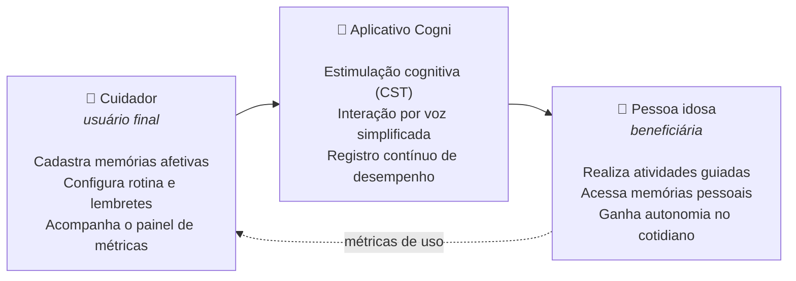
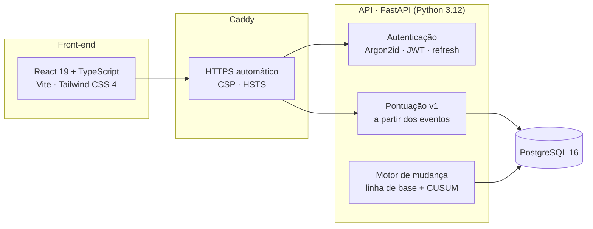

<div align="center">

# 🧠 Cogni

**Ferramenta digital de apoio ao cuidador no cuidado de idosos com doenças neurodegenerativas**

*Estimulação cognitiva, memória afetiva e métricas para quem cuida.*

Trabalho de Conclusão de Curso · Engenharia de Software · Unicesumar Curitiba · 2026


</div>

---

## 📋 Sumário

- [O problema](#-o-problema)
- [A solução](#-a-solução)
- [Base científica](#-base-científica)
- [Funcionalidades](#-funcionalidades)
- [Métricas do painel do cuidador](#-métricas-do-painel-do-cuidador)
- [Jogos cognitivos](#-jogos-cognitivos)
- [Mercado e diferenciais](#-mercado-e-diferenciais)
- [Arquitetura e tecnologias](#-arquitetura-e-tecnologias)
- [Estado atual do projeto](#-estado-atual-do-projeto)
- [Cronograma](#-cronograma)
- [Como executar](#-como-executar)
- [Estrutura do projeto](#-estrutura-do-projeto)
- [Design e acessibilidade](#-design-e-acessibilidade)
- [Equipe](#-equipe)
- [Referências](#-referências)

---

## 🔎 O problema

O envelhecimento da população brasileira traz um aumento contínuo dos casos de demência.

| Dado | Contexto |
| --- | --- |
| **1,8 milhão** | de brasileiros com 60 anos ou mais vivem hoje com algum tipo de demência |
| **5,5 milhões** | é a projeção para 2050, passando por 2,8 milhões já em 2030 |
| **+80%** | dos casos de demência no Brasil permanecem sem diagnóstico |
| **16,6%** | da população brasileira é idosa (cerca de 35 milhões de pessoas) |

<sub>Fontes: IBGE (PNAD Contínua, 2025); ABRAZ (2025).</sub>

Essa realidade atinge **duas pessoas ao mesmo tempo**:

- **A pessoa idosa:** o avanço de doenças neurodegenerativas, como o Alzheimer, traz perda de memória, dificuldade para reconhecer pessoas e lugares e redução da autonomia no dia a dia.
- **O cuidador familiar:** cuidar de alguém com demência gera sobrecarga emocional, física e financeira. É difícil acompanhar, monitorar e ajustar o cuidado de forma contínua.

### A lacuna

As soluções existentes tendem a **apenas informar ou monitorar**. Faltam ferramentas que apoiem o cuidador com metodologia validada e com **dados que ajudem a decidir** o que fazer no cuidado diário. Uma revisão sistemática publicada na *JMIR Aging* (2024) aponta que os aplicativos de cuidado de demência carecem de informação de qualidade e adaptada às necessidades reais do cuidador.

---

## 💡 A solução

O **Cogni** coloca **o cuidador no centro do cuidado**. Ele é o usuário final do sistema, e a pessoa idosa é a beneficiária.



**Ciclo de valor:** as métricas geradas pelo uso da pessoa idosa voltam ao cuidador em forma de painel. O resultado é um ciclo de **acompanhamento e decisão**, e não apenas de entretenimento cognitivo.

---

## 📚 Base científica

Cada funcionalidade se apoia em evidências publicadas:

| Área | Evidência | Fonte |
| --- | --- | --- |
| **Estimulação cognitiva** | Cerca de **6 meses de atraso** no declínio esperado em demência leve a moderada. Sessões duas vezes por semana tendem a render mais. | Cochrane, Woods et al. (2023) |
| **Memória afetiva** | Benefícios pequenos, porém consistentes, em qualidade de vida, cognição, comunicação e humor. | Cochrane, Woods et al. (2018) |
| **Monitoramento** | Registro, autoavaliação e alertas ativam a autorregulação do cuidador e **reduzem a sobrecarga**. | Revisão sistemática, Deliu (2026) |

---

## ✨ Funcionalidades

A funcionalidade central é o **painel de métricas do cuidador**, que reúne desempenho cognitivo, engajamento, adesão à rotina e alertas em um só lugar. Ao redor dele estão as funcionalidades abaixo.

| # | Funcionalidade | Descrição | Status |
| :-: | --- | --- | :-: |
| ⭐ | **Painel de métricas** | Indicadores, tendências e avisos de cada pessoa, comparada com o próprio padrão | 🟢 Funcionando |
| 1 | **Jogos cognitivos** | Quatro jogos que gravam cada toque e tempo de reação, alinhados à Terapia de Estimulação Cognitiva (CST) | 🟢 Funcionando |
| 2 | **Memória afetiva** | Fotos e histórias de pessoas importantes | 🟡 Planejado |
| 3 | **Lugares familiares** | Fotos e informações de locais conhecidos | 🟡 Planejado |
| 4 | **Comandos por voz** | Menos navegação por menus para a pessoa idosa | 🟡 Planejado |
| 5 | **Rotina e lembretes** | Atividades, compromissos e horários | 🟡 Planejado |
| 6 | **Dificuldade adaptativa** | Nível ajustado ao desempenho do usuário | 🟠 Parcial (seleção manual de nível) |
| 7 | **Mensagens afetivas** | Estímulos de familiares durante o uso | 🟡 Planejado |
| 8 | **Relatórios exportáveis** | Métricas para compartilhar com especialistas (CSV por pessoa; exportação completa da conta em JSON) | 🟢 Funcionando |

<sub>🟢 implementado com dados reais · 🟠 parcialmente implementado · 🟡 previsto nas próximas etapas</sub>

### Telas já implementadas

- **Entrar, criar conta, esqueci a senha e redefinir senha**, ligados à API (senha com Argon2id, sessão renovada por cookie seguro).
- **Painel inicial** com pessoas acompanhadas, sessões do dia, avisos e sessões recentes, tudo vindo do banco.
- **Cadastro, lista e perfil** de cada pessoa, com estado em relação ao próprio padrão, sessões que faltam para formar a linha de base, **gráfico radar** dos cinco domínios e evolução de 8 semanas.
- **Quatro jogos** que gravam os eventos brutos (cada estímulo, toque, omissão e tempo de reação) e salvam a sessão no servidor, que calcula a pontuação.
- **Relatórios** por pessoa e por período (semana, mês ou 3 meses), com sessões por semana e exportação em CSV.
- **Análises**: avisos, melhoras, sugestões e padrões em formação gerados pelo motor estatístico, com perguntas rápidas respondidas a partir dos dados reais.

---

## 🏗 Arquitetura e tecnologias

O Cogni roda inteiro em componentes abertos: nenhuma parte depende de um fornecedor específico. Tudo sobe com Docker Compose em qualquer servidor Linux, Windows ou macOS.



| Camada | Tecnologias | Papel |
| --- | --- | --- |
| **Front-end** | React 19, TypeScript, Vite, Tailwind CSS 4, React Router 7 | Interface do cuidador e dos jogos |
| **API** | FastAPI, SQLAlchemy 2, Alembic, Pydantic | Autenticação, cadastros, sessões, pontuação e análises |
| **Banco** | PostgreSQL 16 | Dados das pessoas, sessões e eventos brutos de cada jogo |
| **Infraestrutura** | Docker Compose, Caddy, scripts de backup e restauração | Implantação em qualquer servidor, HTTPS e cópias de segurança |
| **Qualidade** | pytest, Vitest, Ruff, GitHub Actions | Testes e verificações a cada envio |

### 📈 Como os dados viram informação

1. Cada jogo grava **eventos brutos**: estímulo, toque, omissão, tentativa e tempo de reação em milissegundos.
2. O servidor calcula a **pontuação v1** desses eventos e guarda a versão da fórmula, para que dados antigos possam ser recalculados.
3. O **motor de mudança** compara cada pessoa com ela mesma: descarta as 6 primeiras sessões de cada jogo (aprendizado), forma a linha de base com as 12 seguintes (mediana e MAD) e acompanha as próximas com um **CUSUM** bilateral. Um aviso só aparece quando a mudança se sustenta por várias sessões.
4. Os textos para o cuidador são **não diagnósticos**: mostram mudança em relação ao padrão da própria pessoa e sugerem conversar com a equipe de saúde.

### 🔒 LGPD desde o início

Por lidar com **dados sensíveis de saúde**, cada cuidador só acessa as pessoas a que está vinculado (outros recebem 404), todo acesso a dados de uma pessoa fica registrado em log de auditoria, o aceite do termo é gravado como consentimento e o cuidador pode **exportar** ou **apagar** a própria conta. A interface não carrega nada de terceiros: a fonte é servida pelo próprio app.

---

## 🚧 Estado atual do projeto

**Concluído:** telas, API própria com PostgreSQL, login, cadastro, recuperação de senha, cadastro de pessoas, jogos salvando sessões reais, relatórios, análises do motor estatístico, testes automatizados e CI.

**Próximas etapas:** memória afetiva, rotina e lembretes, comandos por voz e dificuldade adaptativa. O plano detalhado está em [`docs/PLANO.md`](docs/PLANO.md).

---

## 🗓 Cronograma

Cronograma da disciplina **ESOFT6 – TCC1** (versão atualizada pela instituição):

| Semana | Datas | Etapa | Status |
| :-: | --- | --- | :-: |
| 1 | 04–05/ago | Primeira semana: orientação das equipes | ✅ |
| 2 | 11–12/ago | Entrega do cronograma | ✅ |
| 3 | 18–19/ago | Entrega do tema, integrantes, objetivo e justificativa | ✅ |
| 4 | 25–26/ago | Pesquisa bibliográfica e pesquisa de mercado | ✅ |
| 5 | 01–02/set | Lista de requisitos funcionais | ✅ |
| 6 | 09/set | Definição das tecnologias do projeto (08/set feriado) | ✅ |
| 7 | 15–16/set | Protótipo de telas e navegabilidade | ✅ |
| 8 | 22–23/set | 🎤 Semana de provas: defesa do projeto | ✅ |
| 9 | 29–30/set | Implementação das telas | ✅ |
| 10 | 06–07/out | Implementação do banco, prevendo suporte à gestão | ✅ |
| 11 | 14/out | Implementação das telas e do banco (13/out feriado) | ✅ |
| 12 | 20–21/out | Login, cadastro de usuários e "esqueci minha senha" | ✅ |
| 13 | 27–28/out | 🎤 Apresentação: fluxo de processos e login funcionando | ✅ |
| 14 | 03–04/nov | Correções e implementação dos cadastros básicos | ✅ |
| 15 | 10–11/nov | Implementação dos cadastros básicos (continuação) | ✅ |
| 16 | 17–18/nov | Preparação do documento do TCC1 para entrega | ✅ |
| 17 | 24–25/nov | 🎤 Semana de provas: defesa do projeto | ⏳ |
| 18 | 01–02/dez | Correções e entrega do documento e do código | ⏳ |
| 19 | 08–09/dez | Reapresentação, caso necessário | ⏳ |

<sub>✅ concluído · 🔄 em andamento · ⏳ a fazer · 🎤 apresentação</sub>
---

## 🚀 Como executar

### Pré-requisitos

- [Docker](https://docs.docker.com/get-docker/) com Docker Compose (para o banco e a API)
- [Node.js](https://nodejs.org/) 22 e [pnpm](https://pnpm.io/) 10 (para o front-end)

> Se você usa o [mise](https://mise.jdx.dev/), as versões de Node.js e pnpm estão no arquivo `.mise.toml`. Basta rodar `mise install`.

### Passo a passo

```bash
git clone https://github.com/MylenaLuz/cogni.git
cd cogni
cp .env.example .env
docker compose up -d --build
docker compose exec api python -m app.seed
pnpm install
pnpm dev
```

O `docker compose` sobe o PostgreSQL e a API em **http://localhost:8000** (as migrações rodam sozinhas). O seed cria uma conta de demonstração com três pessoas fictícias e meses de sessões simuladas. O front-end fica em **http://localhost:8443**.

### Conta de demonstração

| Campo | Valor |
| --- | --- |
| E-mail | `demo@cogni.app` |
| Senha | `cuidar-com-dados` |

Os dados de demonstração são **fictícios**. Nenhum dado real de pessoa idosa é usado no projeto.

### Produção

```bash
docker compose -f docker-compose.prod.yml up -d --build
```

O Caddy serve o front-end (pasta `dist/`, gerada por `pnpm build`) e a API em `/api`, com HTTPS automático. Os scripts `infra/backup.sh` e `infra/restore.sh` fazem e restauram cópias do banco.

### Scripts disponíveis

| Comando | Descrição |
| --- | --- |
| `pnpm dev` | Inicia o front-end em modo de desenvolvimento |
| `pnpm build` | Gera a versão de produção na pasta `dist/` |
| `pnpm typecheck` | Verifica os tipos do TypeScript |
| `pnpm test` | Roda os testes do front-end (Vitest) |
| `cd backend && uv run pytest` | Roda os testes da API |

---

## 📁 Estrutura do projeto

```text
cogni/
├── docker-compose.yml         # Banco e API para desenvolvimento
├── docker-compose.prod.yml    # Banco, API e Caddy para produção
├── infra/                     # Caddyfile, backup e restauração
├── backend/
│   ├── alembic/               # Migrações do banco
│   ├── app/
│   │   ├── main.py            # Aplicação FastAPI
│   │   ├── models.py          # Tabelas (SQLAlchemy)
│   │   ├── routers/           # auth, pacientes, conta
│   │   ├── services/
│   │   │   ├── pontuacao.py   # Pontuação v1 a partir dos eventos
│   │   │   └── motor.py       # Linha de base e CUSUM
│   │   └── seed.py            # Dados fictícios de demonstração
│   └── tests/
├── docs/                      # Plano e documento do TCC
└── src/
    ├── App.tsx                # Rotas e pessoa ativa
    ├── api/                   # Cliente HTTP e tipos da API
    ├── state/                 # Sessão do cuidador e dados do painel
    ├── lib/                   # Gravação de eventos, pontuação, embaralhamento
    ├── components/
    └── screens/               # Telas e jogos
```

---

## 🎨 Design e acessibilidade

O visual foi pensado para ser **acolhedor sem ser infantilizado**, com respeito ao público adulto e idoso.

| Elemento | Decisão |
| --- | --- |
| **Cor primária** | Azul-petróleo `#2C7A7A`: transmite calma e confiança sem parecer hospitalar |
| **Fundo** | Tom areia `#F7F2E9`, evitando o excesso de branco puro |
| **Destaque** | Verde-menta `#52B788` para progresso e acertos |
| **Erro** | Vermelho suave `#D96B6B`, usado de forma não punitiva |
| **Tipografia** | [Nunito](https://fonts.google.com/specimen/Nunito), uma sans-serif humanista e legível |

Outras diretrizes seguidas:

- Contraste alto entre texto e fundo.
- Ícones sempre acompanhados de texto.
- Áreas de toque grandes e poucos elementos por tela.
- Feedback imediato e não punitivo de acerto e erro.
- Layout pensado primeiro para dispositivos móveis.

---

## 👥 Equipe

| Integrante |
| --- |
| Kimberly Valle |
| Lucas Matheus Vaz |
| Mylena Alves |

**Curso:** Engenharia de Software · **Instituição:** Unicesumar, Curitiba · **Ano:** 2026

---

## 📖 Referências

As referências completas estão no documento do TCC.

- ABRAZ – Associação Brasileira de Alzheimer (2025).
- Crippa (2023).
- Deliu (2026). Revisão sistemática sobre monitoramento e autorregulação do cuidador.
- FEBRAZ – Federação Brasileira das Associações de Alzheimer (2024).
- IBGE. Pesquisa Nacional por Amostra de Domicílios Contínua – PNAD Contínua (2025).
- IFCE (2022).
- JMIR Aging (2024). Revisão sistemática sobre aplicativos de cuidado de demência.
- Sebrae (2023).
- Woods, B. et al. (2018). *Reminiscence therapy for dementia*. Cochrane Database of Systematic Reviews.
- Woods, B. et al. (2023). *Cognitive stimulation to improve cognitive functioning in people with dementia*. Cochrane Database of Systematic Reviews.

---

<div align="center">

⚠️ O Cogni é um projeto acadêmico. As métricas e alertas **apoiam o cuidado, mas não substituem avaliação, diagnóstico ou acompanhamento feitos por profissionais de saúde**.

</div>
